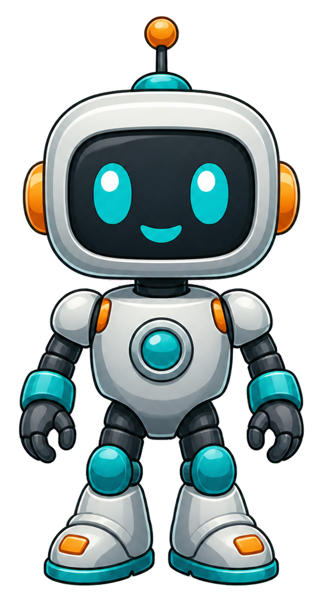
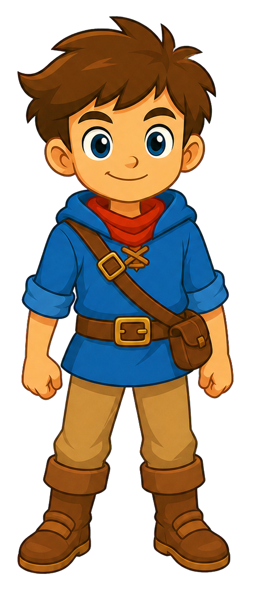
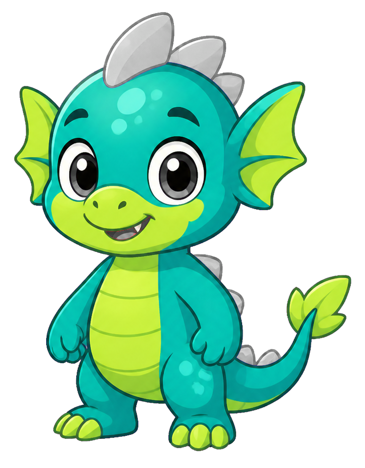
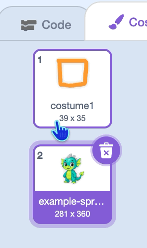

## 2B - Upload Player

Upload a costume for your **player**.

The **player** sprite already has code for gravity, jumping, and falling, so be careful not to delete it.


## Step 1

Make sure you have the image you want to use saved onto your computer.

> [!TIP]
>
> You can try using one of these:
>
> [{:width="300px"}](images/example-sprite-player-robot.png)
>
> [{:width="300px"}](images/example-sprite-player-adventurer.png)
>
> [{:width="300px"}](images/example-sprite-player-creature.png)

## Step 2

> [!TASK]
>
> Select the **player** sprite in the sprite pane.
>
> {:width="200px"}

## Step 3

> [!TASK]
>
> Open the **Costumes** tab.
>
> {:width="450px"}

## Step 4

> [!TASK]
>
> Choose the **Upload Costume** icon.
>
> {:width="250px"}

## Step 5

> [!TASK]
>
> Select the image file from your computer. Scratch will add it as a new costume.

## Step 6

> [!TASK]
>
> Delete the other costume.
>
> {:width="200px"}

## Step 7

> [!TASK]
>
> Click on the **Code** tab.
>
> {:width="450px"}

## Step 8

> [!TASK]
>
> Set the `x: y:`{:class="block3motion"} position and `direction`{:class="block3motion"} of your player. When the green flag is clicked, your player will go back to this starting position.
>
> ```blocks3
> when flag clicked
> go to x: (-200) y: (-120)
> point in direction (90)
> ```


## Step 9

> [!TASK]
>
> Use the dial to choose which way your player faces when the game starts.
> 
> {:width="450px"}


## Step 10

> [!TASK]
>
> Change the `size`{:class="block3looks"} of your player to make it the right size for your game.
>
> ```blocks3
> when flag clicked
> go to x: (-200) y: (-120)
> point in direction (90)
> + set size to (70) %
> ```


## Test

> [!TASK]
>
> Check that the **player** sprite shows your new costume on the Stage.
