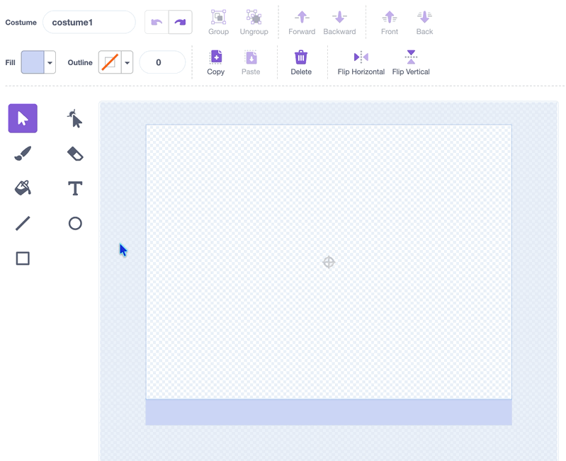

## 3B - Draw foreground platforms

Draw platforms so the **player** has places to stand and jump.

## Step 1

> [!TASK]
>
> Select the **platform** sprite in the sprite pane.
>
> {:width="200px"}

## Step 2

> [!TASK]
>
> Open the **Costumes** tab.
>
> {:width="450px"}

## Step 3

> [!TASK]
>
> You can redraw the **floor** along the bottom of the Stage. Select it with the arrow tool, click **Delete**, then use the paint tools to draw a new one.
>
> {:width="450px"}
>
> The **floor** stops your **player** falling off the bottom of the Stage, so make sure your new floor spans the whole bottom edge and has a straight, horizontal top.

## Step 4

> [!TASK]
>
> Use the paint tools to draw platforms in the **platform** sprite for your **player** to jump on to.
>
> {:width="200px"}
>
> The place where the **player** stands must have a straight, horizontal top.
>
> Draw every platform for the level in this one sprite.
>
> > [!TIP]
> >
> > You can also copy and paste platform images into the paint editor, then arrange them where you want them.

## Step 5

> [!TASK]
>
> Open the **Code** tab.
>
> {:width="450px"}

## Step 6

> [!TASK]
>
> Add a green flag block.
>
> ```blocks3
> +when green flag clicked
> ```

## Step 7

> [!TASK]
>
> Add blocks to show the **platform** sprite, move it to the front layer, put it in the centre of the Stage, and set its size.
>
> ```blocks3
> when green flag clicked
> +show
> +go to [front v] layer
> +go to x: (0) y: (0)
> +set size to (100)%
> ```

## Test

> [!TASK]
>
> Click the green flag and check that the foreground platforms appear in front of the backdrop in the places you chose.
>
> The **player** should be able to stand or jump on each foreground platform.
