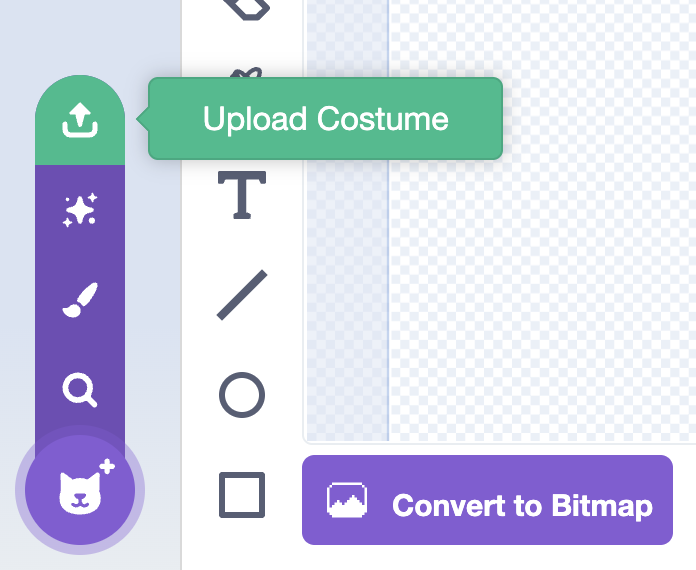
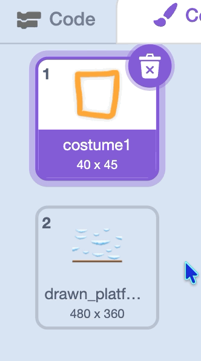

## 3C - Draw Platforms in another editor

To draw fancier platforms and montage other images, you can use an editor on your computer or one online like [pixlr](https://pixlr.com/){:target="_blank"}

## Step 1

> [!TASK]
>
> Create a new file in your editor. Make sure to choose a size of 480 x 360 pixels and a transparent background
>
> {:width="200px"}

## Step 2

> [!TASK]
>
> Draw a new **floor** along the bottom of your image.
>
> The **floor** stops your **player** falling off the bottom of the Stage, so make sure it spans the whole bottom edge and has a straight, horizontal top.

## Step 3

> [!TASK]
>
> Draw the rest of your platforms above the floor. You don't need them to be perfect. You can come back and edit them later.
>
> {:width="450px"}

## Step 4

> [!TASK]
>
> Export or Save your platforms as a PNG file.

## Step 5

> [!TASK]
>
> Select the **platform** sprite in the sprite pane.
>
> {:width="200px"}

## Step 6

> [!TASK]
>
> Open the **Costumes** tab.
>
> {:width="450px"}

## Step 7

> [!TASK]
>
> Choose the **Upload Costume** icon.
>
> {:width="250px"}

## Step 8

> [!TASK]
>
> Select the image file you drew. Scratch will add it as a new costume.

## Step 9

> [!TASK]
>
> Delete the other costume.
>
> {:width="200px"}

## Step 10

> [!TASK]
>
> You can resize and edit your platforms in the costume editor if needed.
>
> > [!TIP]
> >
> > Make sure the top of each platform is completely flat. If the top edge has bumps or stray pixels, the **player** can catch on them and stop moving smoothly.

