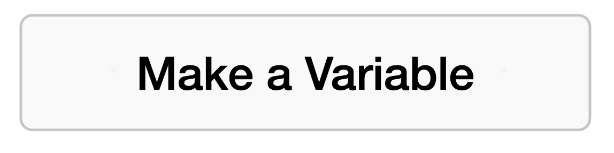
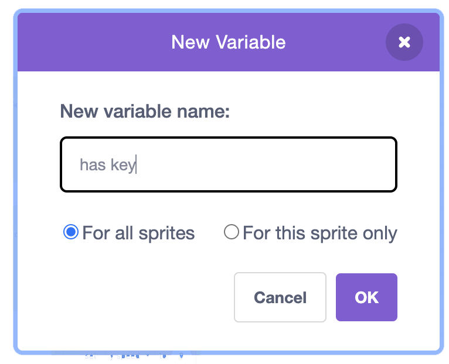
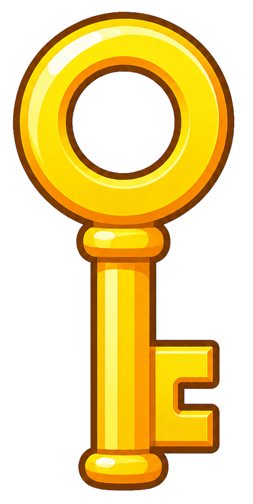
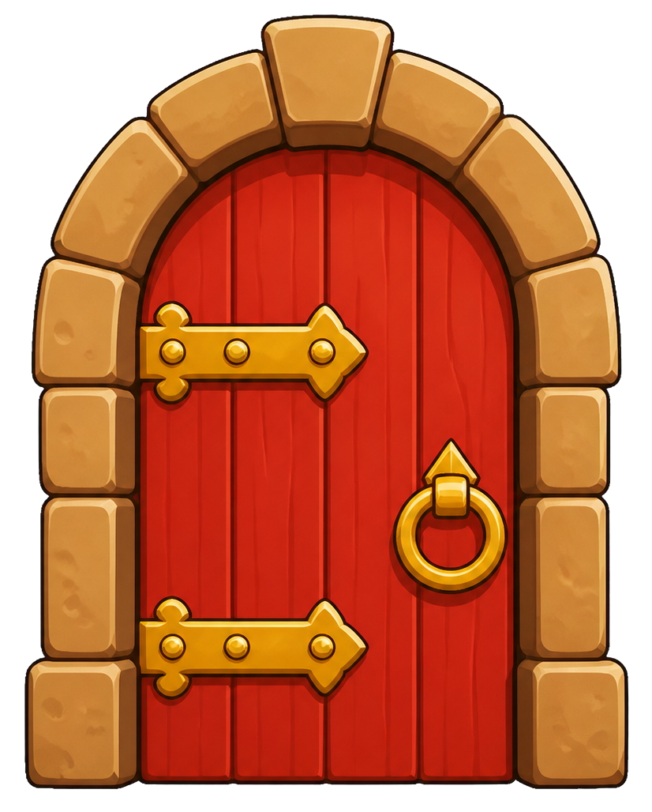

## 8C - Take Key to Exit

Make the player win only after collecting a key and reaching the **Exit**.

## Step 1

> [!TASK]
>
> In the `variable`{:class="block3variables"} menu click **Make a Variable**.
>
> {:width="250px"}

## Step 2

> [!TASK]
>
> Name the variable `has key`{:class="block3variables"}, and make it for all sprites so the Stage, **Key**, and **Exit** sprites can all use it.
>
> Use this exact name so the blocks below match.
>
> {:width="350px"}

## Step 3

> [!TASK]
>
> Place the key somewhere interesting and put the exit where the player can reach it after collecting the key.
>
> {:width="300px"}
>
> {:width="300px"}

## Step 4

> [!TASK]
>
> Select the **Stage** and add a green flag block.
>
> ```blocks3
> when green flag clicked
> set [has key v] to [0]
> ```

## Step 5

> [!TASK]
>
> Select the **Key** sprite and add these blocks.
>
> ```blocks3
> when green flag clicked
> show
> forever
>   if <touching (player v)?> then
>     set [has key v] to [1]
>     hide
>   end
> end
> ```

## Step 6

> [!TASK]
>
> Select the **Exit** sprite and add blocks that check when the player touches it.
>
> ```blocks3
> when green flag clicked
> forever
>   if <touching (player v)?> then
>   end
> end
> ```

## Step 7

> [!TASK]
>
> Inside the `if`{:class="block3control"} block, add another `if`{:class="block3control"} block to check whether `has key`{:class="block3variables"} is `1`.
>
> ```blocks3
> when green flag clicked
> forever
>   if <touching (player v)?> then
> +    if <(has key) = [1]> then
> +    else
> +    end
>   end
> end
> ```

## Step 8

> [!TASK]
>
> In the `has key`{:class="block3variables"} `=`{:class="block3operators"} `1` part, add `broadcast win`{:class="block3events"}.
>
> In the `else`{:class="block3control"} part, add a `say 'Find the key!' for 2 seconds`{:class="block3looks"} block.
>
> ```blocks3
> when green flag clicked
> forever
>   if <touching (player v)?> then
>     if <(has key) = [1]> then
> +      broadcast (win v)
>     else
> +      say [Find the key!] for (2) seconds
>     end
>   end
> end
> ```

## Step 9

> [!TASK]
>
> Add a new `when I receive win`{:class="block3events"} block.
>
> Add `say 'You win!' for 2 seconds`{:class="block3looks"} and `stop all`{:class="block3control"}.
>
> If you already added this win block in another route, just check this step off.
>
> ```blocks3
> +when I receive [win v]
> +say [You win!] for (2) seconds
> +stop [all v]
> ```

## Step 10

> [!TASK]
>
> Choose what should happen before `stop all`{:class="block3control"}.
>
> You can use the `when I receive win`{:class="block3events"} block to show a message, play a sound, change backdrop, switch costume, or trigger another sprite before the game stops.
>
> Put any extra win blocks above `stop all`{:class="block3control"}.

## Test

> [!TASK]
>
> Touch the exit before and after collecting the key.
>
> Check that the keyed route broadcasts `win`{:class="block3events"}, shows the win message, and stops the game only **after** the key has been collected.
