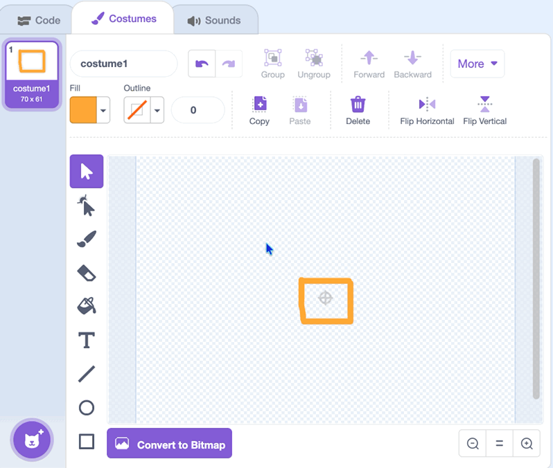

## 2A - Draw Player

Draw a costume for your **player**.

The **player** sprite already has code for gravity, jumping, and falling, so be careful not to delete it.


## Step 1

> [!TASK]
>
> Select the **player** sprite in the sprite pane.
>
> {:width="200px"}
>

## Step 2

> [!TASK]
>
> Open the **Costumes** tab.
>
> {:width="450px"}


## Step 3

> [!TASK]
>
> Select the arrow tool and delete the starter costume. 
>
> {:width="450px"}


## Step 4

> [!TASK]
>
> Use the paint tools to draw a new character. Your player could be a person, robot, creature, animal, or simple shape.
>
> {:width="200px"}


## Step 5

> [!TASK]
>
> Click on the **Code** tab.
>
> {:width="450px"}

## Step 6

> [!TASK]
>
> Set the `x: y:`{:class="block3motion"} position and `direction`{:class="block3motion"} of your player. When the green flag is clicked, your player will go back to this starting position.
>
> ```blocks3
> when flag clicked
> go to x: (-200) y: (-120)
> point in direction ()
> ```


## Step 7

> [!TASK]
>
> Use the dial to set the player's direction when the green flag is clicked.
> 
> {:width="450px"}


## Step 8

> [!TASK]
>
> Change the `size`{:class="block3looks"} of your player. If it is too large you can make it smaller.
>
> ```blocks3
> when flag clicked
> go to x: (-200) y: (-120)
> point in direction ()
> + set size to () %
> ```


**Test:** Check that the **player** sprite shows your new costume on the Stage. 