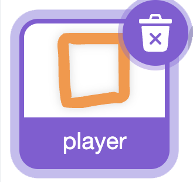
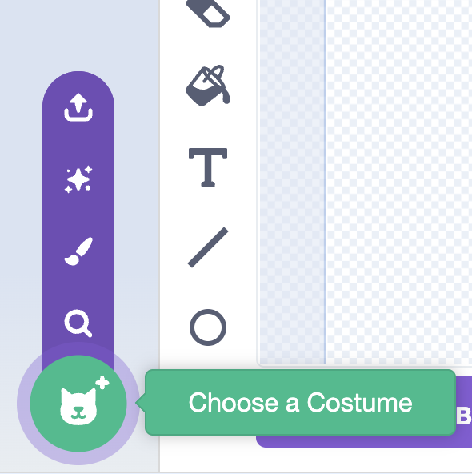
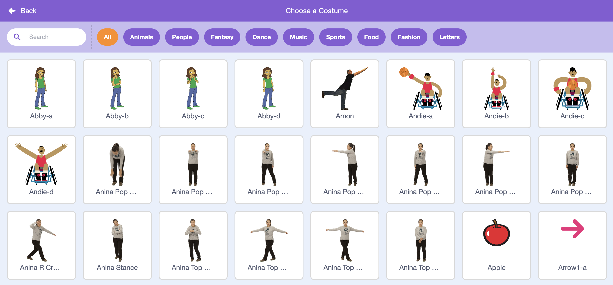
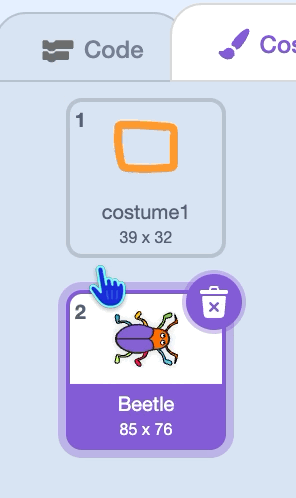
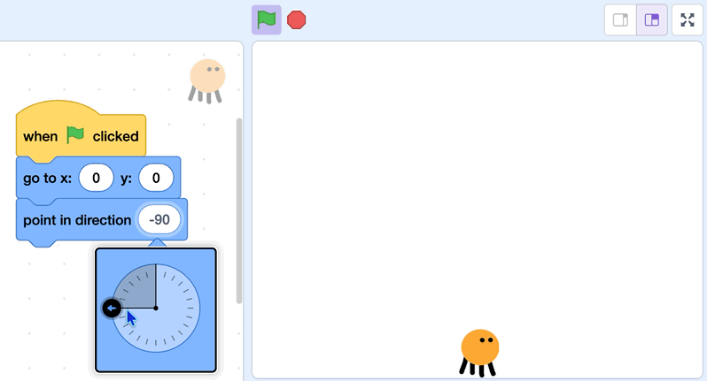

## 2C - Choose Inbuilt Player

Choose a costume for your **player** from the Scratch library.

The **player** sprite already has code for gravity, jumping, and falling, so be careful not to delete it.

## Step 1

> [!TASK]
>
> Select the **player** sprite in the sprite pane.
>
> {:width="200px"}

## Step 2

> [!TASK]
>
> Open the **Costumes** tab.
>
> {:width="450px"}

## Step 3

> [!TASK]
>
> Select **Choose a Costume**.
>
> {:width="250px"}


## Step 4

> [!TASK]
>
> Pick a costume from the Scratch library. 
>
> {:width="450px"}

## Step 5

> [!TASK]
>
> Delete the other costume.
>
> {:width="200px"}

## Step 6

> [!TASK]
>
> Click on the **Code** tab.
>
> {:width="450px"}

## Step 7

> [!TASK]
>
> Set the `x: y:`{:class="block3motion"} position and `direction`{:class="block3motion"} of your player. When the green flag is clicked, your player will go back to this starting position.
>
> ```blocks3
> when flag clicked
> go to x: (-200) y: (-120)
> point in direction (90)
> ```


## Step 8

> [!TASK]
>
> Use the dial to choose which way your player faces when the game starts.
> 
> {:width="450px"}


## Step 9

> [!TASK]
>
> Change the `size`{:class="block3looks"} of your player to make it the right size for your game.
>
> ```blocks3
> when flag clicked
> go to x: (-200) y: (-120)
> point in direction (90)
> + set size to (70) %
> ```


**Test:** Check that the **player** sprite shows your new costume on the Stage. 