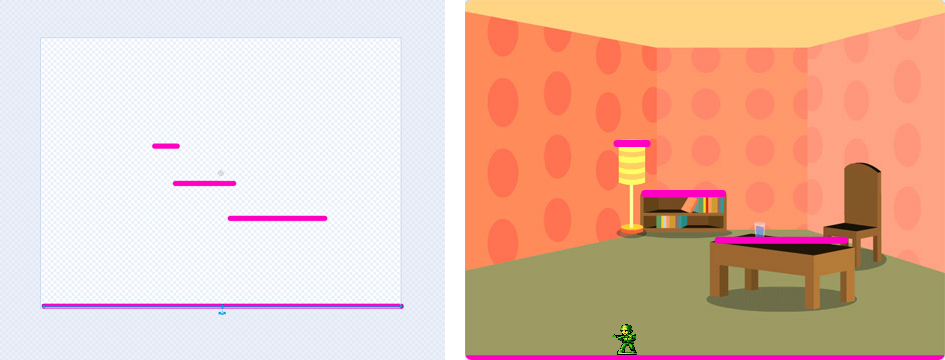

## 3A - Add platforms to match your backdrop


**NOTE - this needs a backdrop first**

Draw platforms to match the parts of your backdrop that your **player** can stand on.

## Step 1

> [!TASK]
>
> Select the **platform** sprite in the sprite pane.
>
> {:width="200px"}

## Step 2

> [!TASK]
>
> Open the **Costumes** tab.
>
> {:width="450px"}

## Step 3

> [!TASK]
>
> Look at your backdrop for things your **player** can stand on, such as a table, shelf, branch or rock. Use a bright colour and draw a horizontal line on top of each one.
>
> {:width="600px"}

## Step 4

> [!TASK]
>
> Open the **Code** tab.
>
> {:width="450px"}

## Step 5

> [!TASK]
>
> Add a green flag block.
>
> ```blocks3
> +when green flag clicked
> ```

## Step 6

> [!TASK]
>
> Add a block to show the **platform** sprite.
>
> ```blocks3
> when green flag clicked
> +show
> ```

**Test:** Click the green flag and check that the **platform** sprite lines appear where the **player** can stand or jump to them.